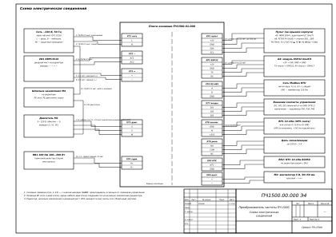

<!-- Файл создаётся автоматически: python3 tools/make_manual.py. Правьте tools/manual/*. -->
# PUFVFD. Руководство по эксплуатации

Преобразователь частоты PUFVFD. Руководство по эксплуатации PUFVFD.00.000 РЭ. Версия программного обеспечения 1.10.

## Введение

Настоящее руководство по эксплуатации (далее — РЭ) распространяется на преобразователь частоты PUFVFD (далее — ПЧ) и содержит сведения о его назначении, технических характеристиках, устройстве, монтаже, настройке, работе, техническом обслуживании, хранении и транспортировании. В РЭ приведено описание всех параметров ПЧ, перечень аварийных сообщений, описание протокола обмена Modbus и примеры применения.

К монтажу и обслуживанию ПЧ допускается персонал, имеющий группу по электробезопасности не ниже III и изучивший настоящее РЭ.

ПЧ изготавливается по открытой конструкторской документации и сертификацию не проходил. Ответственность за безопасность монтажа и эксплуатации несёт организация или лицо, выполнившие сборку и установку.

## 1 Описание и работа

### 1.1 Назначение

Преобразователь частоты PUFVFD (далее — ПЧ) предназначен для плавного пуска, останова и регулирования скорости трёхфазного асинхронного двигателя с короткозамкнутым ротором мощностью до 1,5 кВт при питании от однофазной сети 220 В.

Типовые применения: насосы (в том числе поддержание давления по датчику), вентиляторы и дымососы, конвейеры, станки (сверлильные, токарные, деревообрабатывающие), мешалки, компрессоры, тельферы и подъёмные столы (без функций безопасности).

ПЧ не предназначен для механизмов, отказ которых опасен для жизни (лифты, грузоподъёмные механизмы с людьми, медицинское оборудование), и не обеспечивает функций безопасности (аварийный останов, безопасное отключение момента).

Условия эксплуатации: в закрытом помещении, температура воздуха 0…+40 °C, относительная влажность до 80 % без конденсации, без токопроводящей пыли, агрессивных газов, капель и брызг. Высота над уровнем моря до 1000 м.

### 1.2 Технические характеристики

| Параметр | Значение |
|---|---|
| Питание | 1 фаза, 220 В ±15 %, 50 Гц |
| Потребляемый ток | до 12 А при номинальной нагрузке |
| Выходное напряжение | 3 фазы, 0…220 В (не выше входного) |
| Выходная частота | 0…200 Гц, дискретность 0,01 Гц |
| Мощность двигателя | до 1,5 кВт |
| Номинальный выходной ток | 7 А |
| Перегрузочная способность | 150 % в течение 60 с (настраивается, P27) |
| Способ управления | скалярный U/f (линейная или квадратичная характеристика); бездатчиковый векторный с автонастройкой |
| Частота ШИМ | 4…12 кГц, по умолчанию 8 кГц |
| Время разгона и торможения | 0,1…600 с, два набора, S-рампа |
| Торможение | по рампе с ограничением напряжения шины; постоянным током; встроенный тормозной ключ для внешнего резистора (не менее 50 Ом) |
| Пульт | жидкокристаллический дисплей 20 символов × 4 строки с подсветкой, русский и английский язык, 5 кнопок |
| Дискретные входы | 3 («сухой» контакт на общий провод), двух- и трёхпроводная схема управления |
| Аналоговый вход | 0–10 В или потенциометр 10 кОм |
| Выходное реле | 1 переключающий контакт, только цепи безопасного сверхнизкого напряжения до 30 В, 2 А, 6 функций |
| Интерфейсы | RS-485 Modbus RTU; Wi-Fi (веб-интерфейс, Modbus TCP); Bluetooth |
| Встроенные функции | ПИД-регулятор с режимом «сон», пропуск резонансной частоты, толчковый режим, фиксированная частота, автосброс аварий, защита параметров |
| Защиты | короткое замыкание и сверхток (аппаратная, 23,5 А); мгновенный ток (21 А); перегрузка двигателя (I²t); перенапряжение и пониженное напряжение шины; перегрев радиатора; недогрузка (сухой ход); потеря связи; внешняя авария; неисправность датчиков |
| Габариты корпуса | 210 × 230 × 90 мм без радиатора и ножек |
| Степень защиты | IP20 |
| Охлаждение | радиатор с вентилятором 5 В, управляемым по температуре |

Важная особенность питания от однофазной сети. Напряжение звена постоянного тока под нагрузкой составляет около 290–300 В, поэтому полное напряжение 220 В на двигателе достигается только до частоты примерно 47–48 Гц при номинальном моменте. Выше двигатель работает с немного ослабленным полем. Это свойство всех преобразователей частоты с однофазным входом 220 В и трёхфазным выходом 220 В.

### 1.3 Комплектность

| Наименование | Кол. |
|---|---|
| Преобразователь частоты PUFVFD в корпусе с радиатором и пультом | 1 |
| Модуль связи ESP32 (Wi-Fi, Bluetooth) — установлен в корпусе | 1 |
| Ушки и ножки-проставки для настенного монтажа | по 4 |
| Тормозной резистор 100 Ом 100–200 Вт | по заказу |
| Потенциометр 10 кОм с ручкой | по заказу |
| Руководство по эксплуатации | 1 |

### 1.4 Устройство и работа

Напряжение сети выпрямляется диодным мостом и сглаживается конденсаторами звена постоянного тока (около 310 В). При включении конденсаторы заряжаются через термистор, ограничивающий бросок тока; через 1–2 с термистор шунтируется реле, и на дисплее появляется «ГОТОВ».

Трёхфазный инвертор на интеллектуальном силовом модуле IGBT формирует из постоянного напряжения трёхфазное напряжение регулируемой частоты и амплитуды методом пространственно-векторной ШИМ. Ток двух фаз измеряется датчиками Холла, напряжение шины — изолирующим усилителем.

Микроконтроллер находится на гальванически изолированной стороне: цепи пульта, клемм управления, RS-485 и USB не связаны с сетью. Модуль Wi-Fi/Bluetooth работает как отдельное устройство и опрашивает ПЧ по внутреннему каналу Modbus; при его отказе привод продолжает работать.

Скалярное управление (U/F). Напряжение изменяется пропорционально частоте (или квадрату частоты); на малых частотах добавляется буст. Режим прост и надёжен, не требует знания параметров двигателя.

Векторное управление. ПЧ рассчитывает магнитный поток ротора по модели двигателя (её параметры измеряются автонастройкой) и раздельно регулирует ток намагничивания и ток момента. Скорость вала поддерживается регулятором скорости без датчика на валу. Ниже 3 Гц наблюдатель потока неточен, поэтому на самых малых частотах ПЧ работает с заданным током и расчётным скольжением.

Защиты. Короткое замыкание отключается силовым модулем аппаратно за 1,5 мкс независимо от программы. Остальные защиты программные; при аварии инвертор отключается, двигатель останавливается выбегом, на дисплее выводится код и текст аварии, срабатывает реле (если P41 = АВАРИЯ). Последние четыре аварии хранятся в журнале.

## 2 Использование по назначению

### 2.1 Меры безопасности

- Внутри ПЧ — напряжение до 400 В. После отключения от сети ждите не менее 5 минут, прежде чем открывать корпус; убедитесь, что красный светодиод HL1 на плате погас, и проверьте отсутствие напряжения на клеммах XT3 вольтметром.
- Радиатор (шпилька заземления) и корпус двигателя должны быть надёжно заземлены.
- Питание подаётся только через автоматический выключатель C20. Рекомендуется устройство защитного отключения 30 мА типа A или F.
- Кнопка СТОП и останов по клеммам не отключают двигатель от сети и не являются аварийным остановом. Для работ на механизме отключайте автомат.
- Не включайте контактор или выключатель между ПЧ и двигателем во время работы.
- Не подключайте к выходу ПЧ конденсаторы, варисторы, фильтры, не предназначенные для работы с ПЧ.
- Никогда не подавайте сеть на клеммы двигателя U, V, W — ПЧ выйдет из строя.
- Не проверяйте изоляцию двигателя мегаомметром, не отключив его от ПЧ.
- Функции автозапуска (P33) и автосброса аварий (P68) приводят к самопроизвольному пуску двигателя. Включайте их только там, где это безопасно, и предупредите персонал табличкой на механизме.
- Пользоваться модулем Wi-Fi/Bluetooth для пуска механизма допустимо, только если запуск безопасен для находящихся рядом людей.

### 2.2 Монтаж и подключение

#### 2.2.1 Размещение

ПЧ устанавливается вертикально на стене или монтажной панели, кабельными вводами вниз, на ножках-проставках (между стеной и радиатором должно проходить воздуху). Сверху и снизу оставьте не менее 100 мм свободного пространства, по бокам — 50 мм. Корпус пластиковый: не устанавливайте ПЧ на горючие поверхности и рядом с источниками тепла. Тормозной резистор нагревается выше 100 °C — размещайте его вне корпуса, на негорючем основании.

#### 2.2.2 Двигатель

Подходит трёхфазный асинхронный двигатель до 1,5 кВт, на шильдике которого указано 220/380 В (Δ/Y). Перемычки в клеммной коробке установите по схеме «треугольник» (Δ, 220 В). Двигатель с обозначением только 380 В (Y) при питании 220 В разовьёт около трети мощности.

Длина кабеля двигателя — до 30 м; желателен экранированный кабель с подключением экрана к шпильке заземления.

#### 2.2.3 Клеммы



*Рисунок 1. Схема соединений (полноразмерный лист — PUFVFD.00.000 Э4 в комплекте схем `pdf/01_schematics_eskd.pdf`).*

| Клеммы | Назначение | Провод |
|---|---|---|
| XT1: L, N | сеть 220 В | 2,5 мм² |
| Шпилька М4 на радиаторе | PE сети, PE двигателя, экран кабеля двигателя | 2,5 мм², жёлто-зелёный |
| XT5: U, V, W | двигатель | 1,5–2,5 мм² |
| XT4: R+, R− | тормозной резистор (не менее 50 Ом) | 1,5 мм², термостойкий |
| XT7: DI1, DI2, DI3 | дискретные входы, замыкание на GND | 0,25–1 мм² |
| XT8: GND, AI, +3V3 | общий провод входов; аналоговый вход; питание потенциометра (не нагружать током больше 5 мА) | экранированный |
| XT9: NO, COM, NC | контакты выходного реле (только цепи безопасного сверхнизкого напряжения до 30 В, 2 А; подключать сетевое напряжение 230 В запрещено — для этого используйте промежуточное реле с катушкой 24 В) | 0,5–1,5 мм² |
| XT6: A, B, GND | RS-485 (Modbus RTU) | витая пара |
| Перемычка XP5 | установлена — вход AI 0–10 В; снята — потенциометр 0–3,3 В | — |
| Перемычка XP6 | терминатор RS-485 120 Ом (устанавливается на последнем устройстве линии) | — |

Дискретные входы рассчитаны на «сухие» контакты (кнопки, тумблеры, контакты реле) или выходы с открытым коллектором. Подавать на них напряжение нельзя. Провода управления прокладывайте отдельно от силовых.

#### 2.2.4 Типовые схемы управления

Пуск и останов с пульта, частота кнопками — заводская настройка, подключать ничего не нужно.

Пуск тумблером, частота потенциометром: тумблер между DI1 и GND; потенциометр 10 кОм — крайние выводы на +3V3 и GND, средний — на AI; перемычка XP5 снята. Параметры: P00 = КЛЕММЫ, P01 = ПОТЕНЦИОМЕТР, P46 = ВПЕРЕД/НАЗАД.

Вперёд/назад двумя переключателями (или трёхпозиционным переключателем «назад — стоп — вперёд»): DI1 — «вперёд», DI2 — «назад», общий — GND. P00 = КЛЕММЫ, P46 = ВПЕРЕД/НАЗАД.

Кнопочный пост «ПУСК — СТОП»: кнопка ПУСК (нормально разомкнутая) между DI1 и GND, кнопка СТОП (нормально замкнутая) между DI2 и GND. P00 = КЛЕММЫ, P46 = 3-ПРОВОДНЫЙ. Можно подключить несколько постов: кнопки ПУСК — параллельно, кнопки СТОП — последовательно.

Сигнал 0–10 В от контроллера: AI и GND, перемычка XP5 установлена, P01 = ПОТЕНЦИОМЕТР.

Датчик 4–20 мА: резистор 500 Ом 0,25 Вт между AI и GND, перемычка XP5 установлена, P54 = 20 %, P55 = 100 %.

### 2.3 Пульт управления

```
┌────────────────────┐
│РАБОТА      50.00 Hz│   состояние и выходная частота
│I=  3.4A   U=215V   │   ток двигателя и выходное напряжение
│Udc=305V   t= 42C   │   строка 3 — выбирается параметром P71
│ЗАД.  50.0 Hz  >>   │   задание и направление (>> вперёд, << назад)
└────────────────────┘
 [ПУСК] [СТОП] [▲] [▼] [ВВОД]
```

Состояния: ЗАРЯД — идёт заряд шины после включения; ГОТОВ — можно запускать; РАБОТА; ТОРМОЗ — торможение постоянным током; НАСТР. — автонастройка; СОН — ПИД-регулятор остановил двигатель; АВАРИЯ — с кодом и текстом причины. Знак «!» в правом нижнем углу — действует ограничение тока или напряжения. При включённом ПИД-регуляторе в нижней строке выводятся задание и текущее значение датчика (PV) в процентах.

| Кнопка | На главном экране | В меню |
|---|---|---|
| ПУСК | пуск (если P00 = ПУЛЬТ) | то же |
| СТОП | останов при любом источнике команд; сброс аварии | отмена изменения / выход |
| ▲ ▼ | изменение задания частоты (P01 = ПУЛЬТ) или задания ПИД; удержание ускоряет | выбор параметра / изменение значения |
| ВВОД | вход в меню параметров | начать изменение / записать значение |

Для изменения параметра нажмите ВВОД, кнопками ▲ ▼ выберите номер параметра (P00…P73) и снова нажмите ВВОД — слева замигает символ «>». Кнопками ▲ ▼ установите значение (в нижней строке показан допустимый диапазон) и нажмите ВВОД. Значение сразу сохраняется в энергонезависимой памяти и сохраняется после отключения питания. СТОП отменяет изменение. Параметры, помеченные «только при останове», при работающем двигателе не редактируются — на экране надпись «ТОЛЬКО ПРИ ОСТАНОВЕ».

Защита от самозапуска. После останова кнопкой СТОП или после аварии повторный пуск от клемм или по Modbus возможен только после снятия и новой подачи команды пуска.

### 2.4 Ввод в эксплуатацию

#### 2.4.1 Первое включение

1. Проверьте подключение по 2.2: сеть — на XT1, двигатель — на XT5, заземление — на шпильку радиатора.
2. Включите автомат. На дисплее «ЗАРЯД», через 1–2 с — «ГОТОВ», напряжение шины 300–320 В.
3. Введите данные с шильдика двигателя: P11 (напряжение, 220), P12 (ток для схемы Δ), P13 (частота), P14 (обороты), P15 (cos φ).
4. Установите время разгона P05 и торможения P06 (для начала 5–10 с).
5. Кнопками ▲ ▼ на главном экране задайте 10 Гц, нажмите ПУСК. Проверьте направление вращения; если оно неверное — отключите питание, выждите 5 минут и поменяйте местами два любых провода двигателя (или используйте отрицательное задание).
6. Увеличьте частоту до 50 Гц, проверьте ток и останов.

#### 2.4.2 Настройка векторного режима

1. Выполните п. 8.1. Двигатель остановлен.
2. Установите P21 = ЗАПУСК и нажмите ПУСК. Около 6 с на дисплее «НАСТР.», слышен тон, вал не вращается. Результат записывается в P16–P20.
3. Для большей точности: в режиме U/F на 30–40 Гц без нагрузки прочитайте ток, запишите его в P20 и повторите автонастройку.
4. Установите P07 = ВЕКТОР, запустите двигатель.
5. Подстройка: колебания скорости — уменьшить P24 или увеличить P25; вялая реакция на нагрузку — увеличить P24; скорость под нагрузкой ниже заданной — увеличить P17 на 10–20 %.

#### 2.4.3 Рекомендуемые настройки по типу механизма

| Механизм | Рекомендации |
|---|---|
| Центробежный насос, вентилятор | P07 = U/F, P47 = КВАДРАТИЧНАЯ, P10 = НЕТ, P04 = 20–25 Гц, P05/P06 = 10–20 с; при необходимости ПИД (2.5.7) |
| Конвейер, транспортёр | P07 = ВЕКТОР, P48 = 20–30 %, P22 = 4–6 % (если U/F), P08 = РАМПА |
| Станок (сверлильный, токарный) | P07 = ВЕКТОР, P05/P06 = 2–5 с, тормозной резистор для быстрого останова шпинделя |
| Компрессор, тяжёлый пуск | P07 = ВЕКТОР или U/F с P22 = 5–8 %, P26 = 150–180 % |
| Мешалка, экструдер | P07 = ВЕКТОР, P66/P67 — защита от обрыва передачи |

### 2.5 Описание параметров

Номер параметра совпадает с адресом регистра хранения Modbus. В регистре хранится целое число: показанное значение, умноженное на 10, 100 или 1000 в зависимости от числа знаков после запятой (указано в таблице каждого параметра). Например, P05 = 5,0 с хранится как 50.

Сводная таблица параметров приведена в приложении А, форма для записи настроек объекта — в приложении Б.

#### 2.5.1 Управление и задание частоты

##### P00 ИСТОЧНИК КОМАНД

| Диапазон | По умолчанию | Регистр Modbus | Изменение |
|---|---|---|---|
| 0 — ПУЛЬТ; 1 — КЛЕММЫ; 2 — MODBUS | ПУЛЬТ | 0 (0x0000) | только при останове |

Определяет, откуда приходит команда пуска и останова.

- ПУЛЬТ — кнопки ПУСК и СТОП на передней панели.
- КЛЕММЫ — дискретные входы DI1, DI2 (схема подключения выбирается параметром P46).
- MODBUS — бит 0 слова управления (регистр 0x0100) по RS-485, Wi-Fi или Bluetooth.

Кнопка СТОП на пульте останавливает привод при любом значении P00. После останова кнопкой СТОП повторный пуск от клемм или по Modbus возможен только после снятия и новой подачи команды пуска.

##### P01 ИСТОЧНИК ЗАДАНИЯ

| Диапазон | По умолчанию | Регистр Modbus | Изменение |
|---|---|---|---|
| 0 — ПУЛЬТ; 1 — ПОТЕНЦИОМЕТР; 2 — MODBUS | ПУЛЬТ | 1 (0x0001) | в любое время |

Определяет, откуда берётся задание частоты (или задание ПИД-регулятора, если он включён P57).

- ПУЛЬТ — значение P02; на главном экране оно меняется кнопками ▲ ▼.
- ПОТЕНЦИОМЕТР — аналоговый вход AI (клеммы XT8): 0 % входа соответствует 0 Гц, 100 % — частоте P03. Масштаб входа задают P54, P55.
- MODBUS — регистр 0x0101 (в сотых долях герца).

Источники команд и задания независимы: например, пуск с клемм, а частота — с потенциометра.

##### P02 ЗАДАННАЯ ЧАСТОТА

| Диапазон | По умолчанию | Регистр Modbus | Изменение |
|---|---|---|---|
| -200,0 … 200,0 Гц | 50,0 Гц | 2 (0x0002), ×10 | в любое время |

Задание частоты при P01 = ПУЛЬТ. Меняется в меню или прямо на главном экране кнопками ▲ ▼ (удержание ускоряет изменение) и сохраняется в энергонезависимой памяти.

Отрицательное значение — вращение назад (если разрешено P10). Задание ограничивается диапазоном P04…P03.

##### P03 МАКС. ЧАСТОТА

| Диапазон | По умолчанию | Регистр Modbus | Изменение |
|---|---|---|---|
| 5,0 … 200,0 Гц | 50,0 Гц | 3 (0x0003), ×10 | в любое время |

Верхний предел выходной частоты для всех источников задания. Одновременно это масштаб: 100 % аналогового входа и 100 % выхода ПИД-регулятора соответствуют P03.

Выше номинальной частоты двигателя (P13) напряжение уже не растёт, двигатель работает с ослабленным полем, и допустимый момент снижается примерно пропорционально f<sub>ном</sub>/f. Не устанавливайте частоту выше допустимой скорости механизма и подшипников двигателя.

##### P04 МИН. ЧАСТОТА

| Диапазон | По умолчанию | Регистр Modbus | Изменение |
|---|---|---|---|
| 0,0 … 50,0 Гц | 0,0 Гц | 4 (0x0004), ×10 | в любое время |

Нижний предел выходной частоты. При поданной команде пуска двигатель вращается не медленнее P04, даже если задание меньше (в том числе ноль).

Используется для насосов и вентиляторов, которым нельзя работать на очень малых оборотах, и для двигателей с собственным вентилятором (ниже 15–20 Гц он плохо охлаждает двигатель).

##### P10 РАЗРЕШИТЬ РЕВЕРС

| Диапазон | По умолчанию | Регистр Modbus | Изменение |
|---|---|---|---|
| 0 — НЕТ; 1 — ДА | ДА | 10 (0x000A) | в любое время |

НЕТ — отрицательное задание (с пульта, по Modbus, от входа «реверс») заменяется нулём; вращение назад невозможно. Установите НЕТ для насосов, вентиляторов и механизмов, которые нельзя вращать в обратную сторону.

##### P49 ЧАСТОТА ПРОПУСКА

| Диапазон | По умолчанию | Регистр Modbus | Изменение |
|---|---|---|---|
| 0,0 … 200,0 Гц | 0,0 Гц | 49 (0x0031), ×10 | в любое время |

Центр полосы частот, в которой привод не может работать длительно (обход механического резонанса: вибрация вентилятора, гул трубопровода). Если задание попадает в полосу, используется ближайшая граница полосы. Разгон и торможение проходят через полосу без задержки.

0 — функция выключена.

##### P50 ПОЛОСА ПРОПУСКА

| Диапазон | По умолчанию | Регистр Modbus | Изменение |
|---|---|---|---|
| 0,0 … 10,0 Гц | 0,0 Гц | 50 (0x0032), ×10 | в любое время |

Ширина полосы пропуска (полностью, по обе стороны от P49). Например, P49 = 25 Гц, P50 = 4 Гц — запрещена работа в диапазоне 23…27 Гц. 0 — функция выключена.

##### P33 АВТОЗАПУСК

| Диапазон | По умолчанию | Регистр Modbus | Изменение |
|---|---|---|---|
| 0 — НЕТ; 1 — ДА | НЕТ | 33 (0x0021) | в любое время |

Поведение после подачи питания, если команда пуска с клемм или по Modbus уже присутствует.

- НЕТ (рекомендуется) — привод не запустится, пока команду не снимут и не подадут снова.
- ДА — привод запустится сразу после заряда шины (примерно через 1–2 с).

На пуск с пульта не влияет. Включайте ДА только там, где самозапуск безопасен для людей (например, вентиляция, насос подкачки).

#### 2.5.2 Разгон, торможение и останов

##### P05 ВРЕМЯ РАЗГОНА

| Диапазон | По умолчанию | Регистр Modbus | Изменение |
|---|---|---|---|
| 0,1 … 600,0 с | 5,0 с | 5 (0x0005), ×10 | в любое время |

Время разгона от 0 до номинальной частоты двигателя P13 (а не до P03). Время разгона до 25 Гц при P13 = 50 Гц будет вдвое меньше.

Слишком малое время вызывает большой пусковой ток: в режиме U/F разгон автоматически приостанавливается при достижении токоограничения P26 (на дисплее «!»); если этого недостаточно — авария E02. Для механизмов с большой инерцией (вентиляторы, центрифуги) время следует увеличить.

##### P06 ВРЕМЯ ТОРМОЖЕНИЯ

| Диапазон | По умолчанию | Регистр Modbus | Изменение |
|---|---|---|---|
| 0,1 … 600,0 с | 5,0 с | 6 (0x0006), ×10 | в любое время |

Время торможения от номинальной частоты P13 до 0.

При торможении двигатель работает генератором и заряжает шину. Если тормозной резистор не установлен (P28 = НЕТ), торможение автоматически приостанавливается при напряжении шины выше 375 В, поэтому фактическое время может быть больше заданного. Если напряжение всё же превысит 400 В — авария E03: увеличьте P06 или установите тормозной резистор.

##### P48 S-РАМПА

| Диапазон | По умолчанию | Регистр Modbus | Изменение |
|---|---|---|---|
| 0 … 50 % | 0 % | 48 (0x0030), ×1 | в любое время |

Скругление начала и конца разгона и торможения (S-образная кривая), в процентах от времени рампы. Убирает рывки при трогании и подходе к заданной частоте — полезно для конвейеров, подъёмных столов, транспортировки жидкостей в открытых ёмкостях.

0 — линейная рампа. С ростом P48 общее время разгона немного увеличивается.

##### P51 ВРЕМЯ РАЗГОНА 2

| Диапазон | По умолчанию | Регистр Modbus | Изменение |
|---|---|---|---|
| 0,1 … 600,0 с | 10,0 с | 51 (0x0033), ×10 | в любое время |

Второе время разгона. Действует, пока замкнут вход DI3 при P39 = РАМПА 2. Применяется, например, для быстрого разгона в наладочном режиме или для мягкого режима при особой нагрузке.

##### P52 ВРЕМЯ ТОРМОЖ. 2

| Диапазон | По умолчанию | Регистр Modbus | Изменение |
|---|---|---|---|
| 0,1 … 600,0 с | 10,0 с | 52 (0x0034), ×10 | в любое время |

Второе время торможения; включается вместе с P51 входом DI3 (P39 = РАМПА 2).

##### P08 СПОСОБ ОСТАНОВА

| Диапазон | По умолчанию | Регистр Modbus | Изменение |
|---|---|---|---|
| 0 — РАМПА; 1 — ВЫБЕГ | РАМПА | 8 (0x0008) | в любое время |

- РАМПА — при снятии команды частота плавно снижается за время P06; затем (если задано) — торможение постоянным током P31, P32.
- ВЫБЕГ — выходы инвертора сразу отключаются, двигатель останавливается свободно под действием нагрузки.

Выбег применяют для механизмов с большой инерцией, где управляемое торможение не нужно, или при отсутствии тормозного резистора и малом допустимом времени останова. Независимо от P08 останов выбегом можно вызвать входом DI3 (P39 = ВЫБЕГ).

##### P31 ВРЕМЯ DC-ТОРМ.

| Диапазон | По умолчанию | Регистр Modbus | Изменение |
|---|---|---|---|
| 0,0 … 30,0 с | 0,0 с | 31 (0x001F), ×10 | в любое время |

Длительность торможения постоянным током в конце останова по рампе (после снижения частоты ниже 0,5 Гц). Постоянный ток в обмотках создаёт неподвижное поле и удерживает вал, гасит остаточное вращение.

0 — функция выключена. Повторная команда пуска прерывает торможение. Не является стояночным тормозом: после окончания времени вал свободен.

##### P32 ТОК DC-ТОРМОЖ.

| Диапазон | По умолчанию | Регистр Modbus | Изменение |
|---|---|---|---|
| 10 … 100 % | 50 % | 32 (0x0020), ×1 | в любое время |

Ток торможения постоянным током в процентах от номинального тока двигателя P12. Большой ток быстрее останавливает вал, но нагревает двигатель; не держите 100 % дольше 5–10 с.

##### P28 ТОРМ. РЕЗИСТОР

| Диапазон | По умолчанию | Регистр Modbus | Изменение |
|---|---|---|---|
| 0 — НЕТ; 1 — ДА | НЕТ | 28 (0x001C) | в любое время |

Укажите ДА, если к клеммам XT4 подключён тормозной резистор.

Тормозной ключ на плате работает автономно (включается при 381 В) независимо от этого параметра; P28 лишь отключает программное ограничение темпа торможения по напряжению шины. При P28 = ДА без резистора торможение может закончиться аварией E03.

#### 2.5.3 Данные двигателя и автонастройка

##### P11 НОМ. НАПРЯЖЕНИЕ

| Диапазон | По умолчанию | Регистр Modbus | Изменение |
|---|---|---|---|
| 100 … 240 В | 220 В | 11 (0x000B), ×1 | только при останове |

Номинальное линейное напряжение двигателя для выбранной схемы соединения обмоток. Двигатель 220/380 В, соединённый треугольником, — 220 В.

При меньшем значении P11 двигатель получает пониженное напряжение (меньше момент, меньше ток холостого хода).

##### P12 НОМ. ТОК

| Диапазон | По умолчанию | Регистр Modbus | Изменение |
|---|---|---|---|
| 1,0 … 10,0 А | 6,5 А | 12 (0x000C), ×10 | только при останове |

Номинальный ток двигателя с шильдика для схемы треугольник (большее из двух значений). Используется для защиты от перегрузки (P27), токоограничения (P26), торможения постоянным током (P32), автонастройки и индикации. Неверное значение приводит к ложным срабатываниям или, наоборот, к отсутствию защиты двигателя.

##### P13 НОМ. ЧАСТОТА

| Диапазон | По умолчанию | Регистр Modbus | Изменение |
|---|---|---|---|
| 20,0 … 200,0 Гц | 50,0 Гц | 13 (0x000D), ×10 | только при останове |

Частота, при которой двигатель получает полное напряжение P11 (обычно 50 Гц). От неё отсчитываются времена разгона и торможения и начинается зона ослабления поля.

##### P14 НОМ. СКОРОСТЬ

| Диапазон | По умолчанию | Регистр Modbus | Изменение |
|---|---|---|---|
| 100 … 12000 об/мин | 1400 об/мин | 14 (0x000E), ×1 | только при останове |

Номинальная частота вращения с шильдика (например, 1400 об/мин). По ней определяются число пар полюсов (1400 об/мин при 50 Гц — 2 пары) и номинальное скольжение, которое используется для компенсации скольжения и в векторном режиме. Указывайте точное значение с шильдика, а не синхронную скорость (1500).

##### P15 КОСИНУС ФИ

| Диапазон | По умолчанию | Регистр Modbus | Изменение |
|---|---|---|---|
| 0,50 … 0,95 | 0,80 | 15 (0x000F), ×100 | только при останове |

Номинальный коэффициент мощности с шильдика. Используется для оценки тока холостого хода, если P20 = 0. Точное значение важно для векторного режима.

##### P21 АВТОНАСТРОЙКА

| Диапазон | По умолчанию | Регистр Modbus | Изменение |
|---|---|---|---|
| 0 — НЕТ; 1 — ЗАПУСК | НЕТ | 21 (0x0015) | только при останове; команда, не сохраняется |

Измерение параметров схемы замещения двигателя для векторного режима. Вал при этом не вращается, двигатель подключён, механизм можно не отсоединять.

Порядок выполнения: при остановленном двигателе установить значение ЗАПУСК и нажать кнопку ПУСК (или подать команду пуска от источника, выбранного P00). На дисплее «НАСТР.», слышен тон 100 Гц, процесс занимает около 6 с. По окончании результаты записываются в P16–P20 и сохраняются, параметр сбрасывается в НЕТ, команда пуска снимается.

Перед автонастройкой обязательно введите P11–P15. При ошибке — авария E08 (обрыв фазы, двигатель не подключён, P12 сильно завышен).

##### P16 R СТАТОРА

| Диапазон | По умолчанию | Регистр Modbus | Изменение |
|---|---|---|---|
| 0,00 … 100,00 Ом | 0,00 Ом | 16 (0x0010), ×100 | только при останове |

Активное сопротивление фазы статора эквивалентной схемы «звезда». Заполняется автонастройкой; можно ввести вручную. Для двигателя 1,5 кВт в треугольнике обычно 1,5…3 Ом. Завышение ухудшает работу на низких частотах.

##### P17 R РОТОРА

| Диапазон | По умолчанию | Регистр Modbus | Изменение |
|---|---|---|---|
| 0,00 … 100,00 Ом | 0,00 Ом | 17 (0x0011), ×100 | только при останове |

Приведённое сопротивление ротора. Заполняется автонастройкой. Определяет расчётное скольжение в векторном режиме: если под нагрузкой скорость заметно ниже заданной — увеличьте P17 на 10–20 %, если выше — уменьшите.

##### P18 L РАССЕЯНИЯ

| Диапазон | По умолчанию | Регистр Modbus | Изменение |
|---|---|---|---|
| 0,0 … 3000,0 мГн | 0,0 мГн | 18 (0x0012), ×10 | только при останове |

Индуктивность рассеяния. Заполняется автонастройкой; типично 10…25 мГн. Используется наблюдателем потока и регуляторами тока.

##### P19 L НАМАГНИЧИВ.

| Диапазон | По умолчанию | Регистр Modbus | Изменение |
|---|---|---|---|
| 0,0 … 3000,0 мГн | 0,0 мГн | 19 (0x0013), ×10 | только при останове |

Индуктивность намагничивания. Рассчитывается при автонастройке по току холостого хода; типично 80…200 мГн.

##### P20 ТОК ХОЛОСТ. ХОДА

| Диапазон | По умолчанию | Регистр Modbus | Изменение |
|---|---|---|---|
| 0,0 … 10,0 А | 0,0 А | 20 (0x0014), ×10 | только при останове |

Ток холостого хода двигателя (действующее значение). 0 — оценивается по P12 и P15. Точнее всего измерить его самостоятельно: в режиме U/F на 30–40 Гц без нагрузки прочитать ток на дисплее, записать в P20 и повторить автонастройку.

#### 2.5.4 Способ управления двигателем

##### P07 РЕЖИМ УПРАВЛЕНИЯ

| Диапазон | По умолчанию | Регистр Modbus | Изменение |
|---|---|---|---|
| 0 — U/F; 1 — ВЕКТОР | U/F | 7 (0x0007) | только при останове |

- U/F (скалярное) — напряжение пропорционально частоте. Универсальный режим: не требует настройки, подходит для любого асинхронного двигателя и для нескольких двигателей на одном преобразователе.
- ВЕКТОР (бездатчиковое векторное) — раздельное управление потоком и моментом по модели двигателя. Точнее держит скорость под нагрузкой (просадка — единицы об/мин), даёт больший момент на малых частотах и быстрее реагирует на наброс нагрузки. Требует автонастройки (P21); при незаполненных P16–P19 пуск запрещён (авария E08). Только один двигатель на преобразователь.

Рекомендация: насосы, вентиляторы — U/F; конвейеры, станки, мешалки, тяжёлый пуск — ВЕКТОР.

##### P22 БУСТ НАПРЯЖЕНИЯ

| Диапазон | По умолчанию | Регистр Modbus | Изменение |
|---|---|---|---|
| 0,0 … 20,0 % | 3,0 % | 22 (0x0016), ×10 | в любое время |

Добавка напряжения на нулевой частоте в процентах от P11 (только U/F). Компенсирует падение напряжения на сопротивлении обмоток и увеличивает пусковой момент. Добавка линейно уменьшается к номинальной частоте.

Увеличивайте, если двигатель не трогается под нагрузкой или гудит на малых частотах. Чрезмерный буст вызывает перегрев двигателя на малых оборотах и срабатывание токовой защиты. Типично 2…6 %.

##### P23 КОМП. СКОЛЬЖЕНИЯ

| Диапазон | По умолчанию | Регистр Modbus | Изменение |
|---|---|---|---|
| 0 … 200 % | 0 % | 23 (0x0017), ×1 | в любое время |

Компенсация скольжения в режиме U/F, в процентах от номинального скольжения. Привод оценивает нагрузку по активному току и поднимает выходную частоту так, чтобы скорость вала меньше зависела от нагрузки. 100 % — полная компенсация. 0 — выключено.

##### P47 ХАРАКТЕРИСТ. U/F

| Диапазон | По умолчанию | Регистр Modbus | Изменение |
|---|---|---|---|
| 0 — ЛИНЕЙНАЯ; 1 — КВАДРАТИЧНАЯ | ЛИНЕЙНАЯ | 47 (0x002F) | только при останове |

Форма зависимости напряжения от частоты в режиме U/F.

- ЛИНЕЙНАЯ — для нагрузки с постоянным моментом (конвейеры, поршневые компрессоры, станки).
- КВАДРАТИЧНАЯ — U ~ f², для центробежных насосов и вентиляторов, у которых момент падает пропорционально квадрату скорости. Снижает ток, нагрев и шум двигателя на малых оборотах, экономит энергию.

##### P24 УСИЛЕНИЕ СКОР.

| Диапазон | По умолчанию | Регистр Modbus | Изменение |
|---|---|---|---|
| 0,5 … 50,0 | 6,0 | 24 (0x0018), ×10 | в любое время |

Пропорциональный коэффициент регулятора скорости (только ВЕКТОР). Больше — быстрее реакция на наброс нагрузки, но возможны колебания скорости и гул. Меньше — мягче, но больше просадка скорости. Типично 4…10.

##### P25 ИНТЕГР. СКОРОСТИ

| Диапазон | По умолчанию | Регистр Modbus | Изменение |
|---|---|---|---|
| 20 … 5000 мс | 200 мс | 25 (0x0019), ×1 | в любое время |

Постоянная интегрирования регулятора скорости (только ВЕКТОР). Меньше — быстрее устраняется статическая ошибка скорости, но возможны колебания. При колебаниях скорости увеличьте P25 или уменьшите P24.

##### P09 ЧАСТОТА ШИМ

| Диапазон | По умолчанию | Регистр Modbus | Изменение |
|---|---|---|---|
| 4,0 … 12,0 кГц | 8,0 кГц | 9 (0x0009), ×10 | только при останове |

Частота коммутации силовых ключей. Выше — тише работа двигателя (меньше слышимый свист) и плавнее ток, но больше нагрев силового модуля. Ниже — меньше нагрев и токи утечки через ёмкость кабеля.

При длинном кабеле двигателя (более 20 м), срабатывании УЗО или высокой температуре окружающего воздуха уменьшите до 4–5 кГц.

##### P44 КОМП. МЕРТВ. ВР.

| Диапазон | По умолчанию | Регистр Modbus | Изменение |
|---|---|---|---|
| 0 — НЕТ; 1 — ДА | ДА | 44 (0x002C) | только при останове |

Компенсация искажения выходного напряжения из-за мёртвого времени ключей. Улучшает форму тока и работу на малых частотах. Выключать только для диагностики.

#### 2.5.5 Дискретные входы и выходное реле

##### P46 РЕЖИМ КЛЕММ

| Диапазон | По умолчанию | Регистр Modbus | Изменение |
|---|---|---|---|
| 0 — ВПЕРЕД/НАЗАД; 1 — ПУСК/РЕВЕРС; 2 — 3-ПРОВОДНЫЙ | ВПЕРЕД/НАЗАД | 46 (0x002E) | только при останове |

Схема управления от клемм (действует при P00 = КЛЕММЫ). Контакты подключаются между входом и общим проводом GND (XT8, контакт 1).

| Значение | DI1 | DI2 | Работа |
|---|---|---|---|
| ВПЕРЕД/НАЗАД | «вперёд» | «назад» | DI1 замкнут — вращение вперёд, DI2 — назад; оба разомкнуты или оба замкнуты — стоп |
| ПУСК/РЕВЕРС | «пуск» | «направление» | DI1 замкнут — работа; DI2 разомкнут — вперёд, замкнут — назад |
| 3-ПРОВОДНЫЙ | кнопка ПУСК (НО, без фиксации) | кнопка СТОП (НЗ, без фиксации) | короткое нажатие ПУСК запускает, нажатие СТОП останавливает; обрыв провода СТОП — останов |

В трёхпроводной схеме направление — вперёд; для реверса используйте DI3 (P39 = РЕВЕРС).

##### P39 ФУНКЦИЯ ВХОДА 3

| Диапазон | По умолчанию | Регистр Modbus | Изменение |
|---|---|---|---|
| 0 — НЕТ; 1 — СБРОС; 2 — ВНЕШ. АВАРИЯ; 3 — ФИКС. ЧАСТОТА; 4 — РЕВЕРС; 5 — ТОЛЧОК; 6 — РАМПА 2; 7 — ПИД ВЫКЛ.; 8 — ВЫБЕГ | СБРОС | 39 (0x0027) | в любое время |

Назначение дополнительного входа DI3 (замыкание на GND).

| Значение | Действие при замыкании DI3 |
|---|---|
| НЕТ | вход не используется |
| СБРОС | сброс аварии (по фронту замыкания) |
| ВНЕШ. АВАРИЯ | останов выбегом с аварией E09 (термоконтакт двигателя, реле давления, аварийная кнопка цепи управления) |
| ФИКС. ЧАСТОТА | работа на частоте P40 вместо задания P01 |
| РЕВЕРС | изменение направления вращения на противоположное |
| ТОЛЧОК | пока замкнут и нет основной команды пуска — вращение на частоте P53 (наладка, позиционирование) |
| РАМПА 2 | действуют времена разгона и торможения P51, P52 |
| ПИД ВЫКЛ. | ПИД-регулятор отключается, частота берётся из источника P01 (ручной режим) |
| ВЫБЕГ | немедленный останов выбегом и запрет пуска, пока вход замкнут |

ВНЕШ. АВАРИЯ не является аварийным остановом по требованиям безопасности: для этого нужна отдельная цепь, отключающая питание.

##### P40 ФИКСИР. ЧАСТОТА

| Диапазон | По умолчанию | Регистр Modbus | Изменение |
|---|---|---|---|
| 0,0 … 200,0 Гц | 10,0 Гц | 40 (0x0028), ×10 | в любое время |

Частота, на которой работает привод при замкнутом DI3 и P39 = ФИКС. ЧАСТОТА. Направление — как у основной команды.

##### P53 ЧАСТОТА ТОЛЧКА

| Диапазон | По умолчанию | Регистр Modbus | Изменение |
|---|---|---|---|
| 0,0 … 50,0 Гц | 5,0 Гц | 53 (0x0035), ×10 | в любое время |

Частота толчкового режима (P39 = ТОЛЧОК). Разгон и торможение — по P05, P06. Толчок работает при любом источнике команд, если основная команда пуска не подана.

##### P41 ФУНКЦИЯ РЕЛЕ

| Диапазон | По умолчанию | Регистр Modbus | Изменение |
|---|---|---|---|
| 0 — АВАРИЯ; 1 — РАБОТА; 2 — ГОТОВ; 3 — F ДОСТИГНУТА; 4 — ОГРАНИЧЕНИЕ; 5 — СОН | АВАРИЯ | 41 (0x0029) | в любое время |

Условие срабатывания выходного реле K2 (контакты XT9: NO, COM, NC; только цепи безопасного сверхнизкого напряжения до 30 В, 2 А).

| Значение | Реле включено, когда |
|---|---|
| АВАРИЯ | привод в аварии (сигнализация, отключение вышестоящего контактора) |
| РАБОТА | инвертор включён (двигатель под напряжением) |
| ГОТОВ | шина заряжена и аварии нет — привод готов к пуску |
| F ДОСТИГНУТА | разгон завершён, частота равна заданию |
| ОГРАНИЧЕНИЕ | действует токоограничение или ограничение по напряжению шины |
| СОН | ПИД-регулятор перевёл привод в режим «сон» |

#### 2.5.6 Аналоговый вход

##### P54 AI НИЖНИЙ ПРЕДЕЛ

| Диапазон | По умолчанию | Регистр Modbus | Изменение |
|---|---|---|---|
| 0,0 … 90,0 % | 0,0 % | 54 (0x0036), ×10 | в любое время |

Значение входного сигнала (в процентах полной шкалы входа), которое соответствует 0 % задания. Полная шкала — 10 В при установленной перемычке XP5 или 3,3 В без неё.

Пример: датчик 2…10 В — P54 = 20 %; датчик 4…20 мА через резистор 500 Ом (2…10 В) — P54 = 20 %, P55 = 100 %. Сигнал ниже P54 считается нулём.

##### P55 AI ВЕРХНИЙ ПРЕД.

| Диапазон | По умолчанию | Регистр Modbus | Изменение |
|---|---|---|---|
| 10,0 … 100,0 % | 100,0 % | 55 (0x0037), ×10 | в любое время |

Значение входного сигнала (в процентах полной шкалы), которое соответствует 100 % задания (частоте P03 или 100 % обратной связи ПИД). Пример: потенциометр, который на практике не доходит до упора, — P55 = 95 %.

##### P56 AI ФИЛЬТР

| Диапазон | По умолчанию | Регистр Modbus | Изменение |
|---|---|---|---|
| 0 … 5000 мс | 100 мс | 56 (0x0038), ×1 | в любое время |

Постоянная времени фильтра аналогового входа. Сглаживает шум и пульсации сигнала датчика. Больше — плавнее, но медленнее реакция (для ПИД-регулятора избыточный фильтр ухудшает устойчивость). 0 — без фильтра.

#### 2.5.7 ПИД-регулятор и режим «сон»

##### P57 ПИД РЕЖИМ

| Диапазон | По умолчанию | Регистр Modbus | Изменение |
|---|---|---|---|
| 0 — ВЫКЛ.; 1 — ПРЯМОЙ; 2 — ИНВЕРСНЫЙ | ВЫКЛ. | 57 (0x0039) | только при останове |

Включает ПИД-регулятор процесса: частота автоматически подбирается так, чтобы сигнал датчика на аналоговом входе (обратная связь) равнялся заданию P58.

- ВЫКЛ. — обычное управление частотой.
- ПРЯМОЙ — сигнал датчика растёт с ростом частоты (насос и датчик давления на нагнетании, вентилятор и датчик расхода). Если сигнал меньше задания — частота повышается.
- ИНВЕРСНЫЙ — сигнал датчика падает с ростом частоты (вентилятор охлаждения и датчик температуры, насос откачки и датчик уровня в резервуаре).

##### P58 ПИД ЗАДАНИЕ

| Диапазон | По умолчанию | Регистр Modbus | Изменение |
|---|---|---|---|
| 0,0 … 100,0 % | 50,0 % | 58 (0x003A), ×10 | в любое время |

Задание регулятора в процентах полной шкалы датчика. Например, датчик 0…10 бар, требуемое давление 4 бар — 40 %. На главном экране задание меняется кнопками ▲ ▼; в нижней строке видны задание (ЗАД.) и текущее значение (PV).

При P01 = MODBUS задание берётся из регистра 0x0101 (в сотых долях процента).

##### P59 ПИД KP

| Диапазон | По умолчанию | Регистр Modbus | Изменение |
|---|---|---|---|
| 0,00 … 100,00 | 1,00 | 59 (0x003B), ×100 | в любое время |

Пропорциональный коэффициент: изменение выхода (в процентах от P03) на 1 % ошибки. Больше — быстрее и точнее, но склонно к колебаниям. Начните с 1,00.

##### P60 ПИД TI

| Диапазон | По умолчанию | Регистр Modbus | Изменение |
|---|---|---|---|
| 0,0 … 600,0 с | 5,0 с | 60 (0x003C), ×10 | в любое время |

Время интегрирования: устраняет статическую ошибку. Меньше — быстрее подтягивает к заданию, но может раскачать систему. 0 — интегральная составляющая выключена (тогда остаётся статическая ошибка). Для насосов обычно 2…10 с, для температуры — 30…300 с.

##### P61 ПИД TD

| Диапазон | По умолчанию | Регистр Modbus | Изменение |
|---|---|---|---|
| 0,00 … 10,00 с | 0,00 с | 61 (0x003D), ×100 | в любое время |

Время дифференцирования: реакция на скорость изменения ошибки. Для насосов и вентиляторов обычно не нужна (0). Помогает в медленных тепловых процессах; вносит чувствительность к шуму датчика.

##### P62 ПИД МИН. ЧАСТОТА

| Диапазон | По умолчанию | Регистр Modbus | Изменение |
|---|---|---|---|
| 0,0 … 200,0 Гц | 20,0 Гц | 62 (0x003E), ×10 | в любое время |

Минимальная частота при работе регулятора; одновременно — частота, с которой регулятор начинает работу после пуска. Насос не должен работать на частоте, при которой он не создаёт напора (обычно 20–30 Гц).

##### P63 СОН: ЧАСТОТА

| Диапазон | По умолчанию | Регистр Modbus | Изменение |
|---|---|---|---|
| 0,0 … 200,0 Гц | 0,0 Гц | 63 (0x003F), ×10 | в любое время |

Режим «сон»: если частота, выданная регулятором, держится не выше P63 дольше P64 — расхода нет, давление поддерживается само, — двигатель останавливается (на дисплее «СОН»). 0 — режим «сон» выключен.

##### P64 СОН: ЗАДЕРЖКА

| Диапазон | По умолчанию | Регистр Modbus | Изменение |
|---|---|---|---|
| 1 … 600 с | 30 с | 64 (0x0040), ×1 | в любое время |

Задержка перехода в режим «сон». Защищает от частых остановов при кратковременном снижении расхода.

##### P65 СОН: ПРОБУЖДЕНИЕ

| Диапазон | По умолчанию | Регистр Modbus | Изменение |
|---|---|---|---|
| 0,1 … 50,0 % | 5,0 % | 65 (0x0041), ×10 | в любое время |

Условие пробуждения: двигатель снова запускается, когда сигнал отклонится от задания (в сторону, требующую работы) больше чем на P65 процентов. Пример: задание 40 %, P65 = 5 % — пробуждение при падении давления ниже 35 %.

#### 2.5.8 Защиты

##### P26 ТОКООГРАНИЧЕНИЕ

| Диапазон | По умолчанию | Регистр Modbus | Изменение |
|---|---|---|---|
| 50 … 180 % | 150 % | 26 (0x001A), ×1 | в любое время |

Ограничение тока двигателя в процентах от P12.

- В режиме U/F при превышении приостанавливается разгон (на дисплее «!»).
- В режиме ВЕКТОР ограничивается момент двигателя.

Независимо от P26 действуют программная защита по мгновенному току (21 А, E02) и аппаратная защита силового модуля (23,5 А, E01).

##### P27 ВРЕМЯ ПЕРЕГРУЗКИ

| Диапазон | По умолчанию | Регистр Modbus | Изменение |
|---|---|---|---|
| 10 … 300 с | 60 с | 27 (0x001B), ×1 | в любое время |

Тепловая защита двигателя (модель I²t): при токе 150 % от P12 привод отключается с аварией E05 через P27 секунд; при меньшей перегрузке — пропорционально позже; при токе ниже 110 % перегрузка не накапливается и постепенно «остывает». Уровень накопленной перегрузки виден на экране (P71) и в регистре 0x020D.

Для двигателей с внешним обдувом допустимо увеличить; для двигателей с собственным вентилятором при длительной работе на низких оборотах — уменьшить.

##### P29 МИН. НАПР. ШИНЫ

| Диапазон | По умолчанию | Регистр Modbus | Изменение |
|---|---|---|---|
| 150 … 280 В | 200 В | 29 (0x001D), ×1 | в любое время |

Порог пониженного напряжения шины постоянного тока. Привод разрешает пуск, когда напряжение выше P29 + 10 В; при работе и снижении ниже P29 — авария E04. Номинальное напряжение шины от сети 220 В — 300…320 В. При слабой сети (длинная линия, сельская сеть) порог можно снизить до 170–180 В, но при напряжении сети ниже 180 В двигатель не разовьёт номинальную мощность.

##### P30 ПЕРЕГРЕВ, ГРАД.

| Диапазон | По умолчанию | Регистр Modbus | Изменение |
|---|---|---|---|
| 50 … 100 °C | 85 °C | 30 (0x001E), ×1 | в любое время |

Температура радиатора, при которой привод отключается с аварией E06. Обрыв или замыкание датчика температуры также вызывает E06. Вентилятор включается при работе инвертора или при температуре выше 45 °C (см. P70).

##### P66 НЕДОГРУЗКА, ТОК

| Диапазон | По умолчанию | Регистр Modbus | Изменение |
|---|---|---|---|
| 0 … 100 % | 0 % | 66 (0x0042), ×1 | в любое время |

Защита от недогрузки (сухой ход насоса, обрыв ремня или муфты): если на установившейся частоте выше 5 Гц ток двигателя ниже P66 % от P12 дольше P67 — авария E12.

Порог подбирают так: измерить ток при нормальной работе и при «сухом ходе» (закрытая задвижка на всасывании), установить P66 посередине. 0 — защита выключена.

##### P67 НЕДОГРУЗКА, ВР.

| Диапазон | По умолчанию | Регистр Modbus | Изменение |
|---|---|---|---|
| 1 … 300 с | 10 с | 67 (0x0043), ×1 | в любое время |

Задержка срабатывания защиты от недогрузки. Не должна быть меньше времени, за которое насос выходит на режим после пуска.

##### P68 АВТОСБРОС, ЧИСЛО

| Диапазон | По умолчанию | Регистр Modbus | Изменение |
|---|---|---|---|
| 0 … 5 | 0 | 68 (0x0044), ×1 | в любое время |

Число автоматических перезапусков после аварии. После аварии привод ждёт P69 секунд, сбрасывает аварию и, если команда пуска сохраняется, запускается снова. Если попытки исчерпаны — остаётся в аварии до ручного сброса. Счётчик обнуляется после 10 минут работы без аварий.

Не действует для аварий E01 (КЗ), E08, E09, E10, E11. Двигатель запускается без участия человека — включайте только там, где это безопасно. 0 — выключено.

##### P69 АВТОСБРОС, ПАУЗА

| Диапазон | По умолчанию | Регистр Modbus | Изменение |
|---|---|---|---|
| 1 … 300 с | 10 с | 69 (0x0045), ×1 | в любое время |

Пауза перед автоматическим перезапуском (P68).

#### 2.5.9 Связь Modbus

##### P34 АДРЕС MODBUS

| Диапазон | По умолчанию | Регистр Modbus | Изменение |
|---|---|---|---|
| 1 … 247 | 1 | 34 (0x0022), ×1 | в любое время |

Адрес привода в сети Modbus RTU (RS-485). У каждого устройства в линии — свой адрес. Модуль ESP32 обращается к приводу по отдельному порту и от этого параметра не зависит.

##### P35 СКОРОСТЬ MODBUS

| Диапазон | По умолчанию | Регистр Modbus | Изменение |
|---|---|---|---|
| 0 — 9600; 1 — 19200; 2 — 38400; 3 — 57600; 4 — 115200 | 19200 | 35 (0x0023) | в любое время |

Скорость обмена по RS-485. Должна совпадать с настройкой ведущего устройства. Изменение действует сразу. Для длинных линий (сотни метров) выбирайте 9600 или 19200.

##### P36 ЧЕТНОСТЬ MODBUS

| Диапазон | По умолчанию | Регистр Modbus | Изменение |
|---|---|---|---|
| 0 — 8N1; 1 — 8E1; 2 — 8O1 | 8N1 | 36 (0x0024) | в любое время |

Формат байта: 8 бит данных, контроль чётности (нет / чёт / нечёт), 1 стоп-бит. Должен совпадать с ведущим устройством.

##### P37 ТАЙМАУТ СВЯЗИ

| Диапазон | По умолчанию | Регистр Modbus | Изменение |
|---|---|---|---|
| 0,0 … 60,0 с | 0,0 с | 37 (0x0025), ×10 | в любое время |

Контроль связи: если привод управляется по Modbus (P00 или P01 = MODBUS) и во время работы нет корректных запросов дольше P37 — останов с аварией E07. Защищает от неуправляемой работы при обрыве линии или отказе контроллера. 0 — контроль выключен.

Учтите: модуль ESP32 сам опрашивает привод 4 раза в секунду, поэтому при установленном модуле контроль фактически следит за исправностью модуля.

#### 2.5.10 Индикация и сервис

##### P38 ЯЗЫК / LANGUAGE

| Диапазон | По умолчанию | Регистр Modbus | Изменение |
|---|---|---|---|
| 0 — РУССКИЙ; 1 — ENGLISH | РУССКИЙ | 38 (0x0026) | в любое время |

Язык надписей на дисплее (русский или английский). Номера параметров и единицы измерения не меняются.

##### P71 СТРОКА 3 ЭКРАНА

| Диапазон | По умолчанию | Регистр Modbus | Изменение |
|---|---|---|---|
| 0 — UDC И ТЕМПЕР.; 1 — СКОРОСТЬ, МОМЕНТ; 2 — МОЩНОСТЬ, ПЕРЕГР. | UDC И ТЕМПЕР. | 71 (0x0047) | в любое время |

Что показывает третья строка главного экрана:

- UDC И ТЕМПЕР. — напряжение шины и температура радиатора;
- СКОРОСТЬ, МОМЕНТ — расчётная скорость вала (с учётом P72) и момент в процентах от номинального;
- МОЩНОСТЬ, ПЕРЕГР. — активная мощность, отдаваемая двигателю, и накопленная перегрузка (100 % — отключение).

##### P72 КОЭФ. СКОРОСТИ

| Диапазон | По умолчанию | Регистр Modbus | Изменение |
|---|---|---|---|
| 0,01 … 100,00 | 1,00 | 72 (0x0048), ×100 | в любое время |

Множитель для индикации скорости: например, передаточное отношение редуктора (скорость выходного вала) или коэффициент пересчёта в м/мин для конвейера. На регистр Modbus 0x0208 не влияет.

##### P70 ВЕНТИЛЯТОР

| Диапазон | По умолчанию | Регистр Modbus | Изменение |
|---|---|---|---|
| 0 — АВТО; 1 — ПОСТОЯННО | АВТО | 70 (0x0046) | в любое время |

- АВТО — вентилятор включён при работе инвертора и при температуре радиатора выше 45 °C.
- ПОСТОЯННО — вентилятор работает всегда, пока есть питание (жаркое помещение, пыль на радиаторе).

##### P73 ЗАЩИТА ПАРАМЕТР.

| Диапазон | По умолчанию | Регистр Modbus | Изменение |
|---|---|---|---|
| 0 — НЕТ; 1 — ДА | НЕТ | 73 (0x0049) | в любое время |

ДА — изменение параметров с пульта запрещено (кроме самого P73); задание частоты кнопками ▲ ▼ остаётся доступным. Защищает настройки от случайного изменения персоналом. Запись по Modbus и через веб-интерфейс не блокируется.

##### P42 КАЛИБРОВКА ТОКА

| Диапазон | По умолчанию | Регистр Modbus | Изменение |
|---|---|---|---|
| 50,0 … 150,0 % | 100,0 % | 42 (0x002A), ×10 | в любое время |

Поправочный коэффициент измерения тока. Сверьте показание тока с токовыми клещами при работе двигателя и скорректируйте: если клещи показывают 4,0 А, а дисплей 3,8 А — P42 = 100 × 4,0 / 3,8 ≈ 105,3 %.

##### P43 КАЛИБРОВКА UDC

| Диапазон | По умолчанию | Регистр Modbus | Изменение |
|---|---|---|---|
| 50,0 … 150,0 % | 100,0 % | 43 (0x002B), ×10 | в любое время |

Поправочный коэффициент измерения напряжения шины. Сверьте показание Udc с вольтметром постоянного тока на конденсаторе шины (только квалифицированный персонал!) и скорректируйте аналогично P42.

##### P45 ЗАВОДСКОЙ СБРОС

| Диапазон | По умолчанию | Регистр Modbus | Изменение |
|---|---|---|---|
| 0 — НЕТ; 1 — СБРОС | НЕТ | 45 (0x002D) | только при останове; команда, не сохраняется |

СБРОС — все параметры, включая данные двигателя, результаты автонастройки и настройки Modbus, возвращаются к заводским значениям (журнал аварий и счётчик наработки сохраняются). Выполняется при остановленном двигателе. После сброса проверьте P34–P36, если привод работает в сети Modbus.


### 2.6 Аварийные сообщения и возможные неисправности

При аварии инвертор отключается, двигатель останавливается выбегом, на дисплее — код и текст. Сброс — кнопкой СТОП, входом DI3 (P39 = СБРОС) или по Modbus (бит 2 слова управления) после устранения причины. Последние четыре аварии хранятся в журнале (регистры 0x020E–0x0211, веб-интерфейс).

Таблица 2.6.1 — Аварийные сообщения

| Код | Сообщение на дисплее | Причина | Что делать |
|---|---|---|---|
| E01 | КЗ / СВЕРХТОК МОДУЛЯ | Сработала аппаратная защита силового модуля: короткое замыкание на выходе, замыкание фазы на корпус, ток выше 23,5 А, просадка питания драйверов 15 В. | Отключить питание, выждать 5 минут. Проверить кабель и двигатель (сопротивление между фазами одинаковое, сопротивление изоляции на корпус — не менее 1 МОм). Если авария повторяется без двигателя — неисправен силовой модуль или его питание. |
| E02 | ПЕРЕГРУЗКА ПО ТОКУ | Мгновенный ток превысил 21 А: слишком быстрый разгон, большой буст, заклинивание механизма, пуск на вращающийся двигатель. | Увеличить P05, уменьшить P22, проверить механизм. В векторном режиме — повторить автонастройку. |
| E03 | ПЕРЕНАПРЯЖЕНИЕ ШИНЫ | Напряжение шины выше 400 В: слишком быстрое торможение нагрузки с большой инерцией, повышенное напряжение сети. | Увеличить P06, установить тормозной резистор (P28 = ДА), проверить напряжение сети. |
| E04 | НИЗКОЕ НАПРЯЖЕНИЕ | Напряжение шины ниже P29 во время работы: просадка или кратковременное пропадание сети, плохой контакт в цепи питания, неисправность реле предзаряда. | Проверить напряжение сети под нагрузкой, затяжку клемм, автомат. При слабой сети — уменьшить P29. |
| E05 | ПЕРЕГРУЗКА ДВИГАТЕЛЯ | Длительная перегрузка двигателя по модели I²t. | Снизить нагрузку, проверить механизм, правильность P12 и P27. Дать двигателю остыть. |
| E06 | ПЕРЕГРЕВ РАДИАТОРА | Температура радиатора выше P30 либо обрыв или замыкание датчика температуры. | Проверить вентилятор, очистить радиатор, обеспечить свободное движение воздуха, проверить датчик RK2 (около 10 кОм при 25 °C). |
| E07 | НЕТ СВЯЗИ MODBUS | Нет обмена по Modbus дольше P37 при управлении по Modbus. | Проверить линию RS-485, терминатор, адрес и скорость, работу ведущего устройства или модуля ESP32. |
| E08 | ОШИБКА АВТОНАСТРОЙКИ | Автонастройка не удалась, или включён векторный режим без результатов автонастройки. | Проверить подключение всех трёх фаз двигателя, правильность P11–P15, выполнить автонастройку (P21). |
| E09 | ВНЕШНЯЯ АВАРИЯ | Замкнут вход DI3 при P39 = ВНЕШ. АВАРИЯ. | Устранить внешнюю причину (термоконтакт, реле давления и т. п.), сбросить аварию. |
| E10 | НЕТ ЗАРЯДА ШИНЫ | Подана команда пуска, но шина не зарядилась за 5 с после включения. | Проверить напряжение сети, термистор RK1, реле K1, предохранитель FU1. |
| E11 | ДАТЧИКИ ТОКА | Смещение нуля датчиков тока вне допуска (проверяется при остановленном двигателе). | Проверить питание +5 В изолированной стороны и датчики DA7, DA8. |
| E12 | НЕДОГРУЗКА / СУХ.ХОД | Ток на установившейся частоте ниже P66 дольше P67: сухой ход насоса, закрыта задвижка, обрыв ремня или муфты. | Проверить наличие воды и состояние механической передачи; при ложных срабатываниях уменьшить P66 или увеличить P67. |

Таблица 2.6.2 — Неисправности, не сопровождающиеся аварийным сообщением

| Признак | Возможная причина и действие |
|---|---|
| Дисплей не светится | нет сети; сгорел предохранитель FU1; неисправен модуль питания A3; не подключён шлейф пульта |
| Дисплей светится, но без символов | подстроить контраст резистором на адаптере дисплея |
| «ЗАРЯД» не сменяется на «ГОТОВ» | напряжение сети ниже 180 В; P29 завышен; обрыв термистора RK1; неверная калибровка P43 |
| Двигатель гудит и не вращается | обрыв фазы; обмотки в «звезде»; мал буст P22; механизм заклинен |
| ПУСК не работает | P00 не равен ПУЛЬТ; не снята блокировка после СТОП (для клемм/Modbus); замкнут DI3 при P39 = ВЫБЕГ |
| Частота не меняется кнопками | P01 не равен ПУЛЬТ; включён ПИД (кнопки меняют задание ПИД) |
| Двигатель греется на малых оборотах | собственный вентилятор двигателя неэффективен ниже 20–25 Гц — нужен внешний обдув или снижение нагрузки; уменьшить P22 |
| Срабатывает УЗО | ток утечки через ёмкость кабеля двигателя; укоротить кабель, уменьшить P09, применить УЗО типа F |
| Помехи радиоприёму и другой электронике | экранированный кабель двигателя, экран — на шпильку заземления; ферритовые кольца на кабель двигателя |

### 2.7 Связь по протоколу Modbus

#### 2.7.1 Физический уровень

- Modbus RTU по RS-485 (клеммник XT6). Адрес — P34 (по умолчанию 1), скорость — P35 (по умолчанию 19200), формат — P36 (8N1, 8E1 или 8O1). Изменение скорости и формата действует сразу.
- Modbus TCP через модуль ESP32, порт 502. Идентификатор устройства в запросе игнорируется. Если привод не ответил, шлюз возвращает исключение 0x0B.

Поддерживаемые функции: 03 и 04 (чтение, до 100 регистров; обе функции читают одно адресное пространство), 06 (запись регистра), 16 (запись нескольких регистров). Широковещательный адрес 0 допустим для записи. Исключения: 01 — функция не поддерживается, 02 — нет такого регистра, 03 — значение вне диапазона, 04 — параметр нельзя менять при работающем двигателе.

#### 2.7.2 Регистры

##### Параметры: 0…73

Адрес равен номеру параметра (см. 2.5 и приложение А). Значения — 16-разрядные целые со знаком. Запись изменяет параметр в оперативной памяти; чтобы сохранить изменения после отключения питания, запишите 1 в регистр 0x0102.

##### Управление

| Адрес | Назначение |
|---|---|
| 0x0100 (256) | Слово управления: бит 0 — пуск; бит 1 — направление «назад»; бит 2 — сброс аварии (по переходу из 0 в 1). Действует при P00 = MODBUS |
| 0x0101 (257) | Задание частоты, 0,01 Гц (5000 = 50,00 Гц); при включённом ПИД-регуляторе — задание регулятора, 0,01 %. Действует при P01 = MODBUS |
| 0x0102 (258) | Запись 1 — сохранить параметры в энергонезависимую память |

При аварии бит пуска сбрасывается приводом; для повторного пуска нужно сбросить аварию и снова записать бит пуска. После нажатия СТОП на пульте пуск блокируется, пока ведущее устройство не запишет 0 в бит пуска.

##### Состояние (только чтение)

| Адрес | Величина | Единица |
|---|---|---|
| 0x0200 (512) | Слово состояния: бит 0 — готов; 1 — работа; 2 — вращение назад; 3 — авария; 4 — частота достигнута; 5 — действует ограничение; 6 — автонастройка; 7 — «сон» ПИД-регулятора | |
| 0x0201 | Код текущей аварии (0 — нет) | |
| 0x0202 | Выходная частота, со знаком | 0,01 Гц |
| 0x0203 | Действующее задание, со знаком | 0,01 Гц |
| 0x0204 | Ток двигателя | 0,01 А |
| 0x0205 | Выходное напряжение | 0,1 В |
| 0x0206 | Напряжение шины постоянного тока | 0,1 В |
| 0x0207 | Температура радиатора, со знаком | 0,1 °C |
| 0x0208 | Скорость (оценка), со знаком | об/мин |
| 0x0209 | Момент (оценка), со знаком | 0,1 % |
| 0x020A | Активная мощность, со знаком | Вт |
| 0x020B | Дискретные входы: бит 0 — DI1, 1 — DI2, 2 — DI3 | |
| 0x020C | Аналоговый вход | 0,1 % |
| 0x020D | Накопленная перегрузка (100 % — отключение) | % |
| 0x020E…0x0211 | Журнал аварий, от последней к более ранним | |
| 0x0212 | Наработка | ч |
| 0x0213 | Версия ПО (110 = 1.10) | |
| 0x0214 | Внутреннее состояние: 0 стоп, 1 подготовка, 2 намагничивание, 3 работа, 4 торможение постоянным током, 5 автонастройка, 6 авария | |
| 0x0215 | ПИД-регулятор: задание | 0,1 % |
| 0x0216 | ПИД-регулятор: обратная связь | 0,1 % |

##### Контроль связи

Если P37 > 0 и привод управляется по Modbus (P00 или P01 = MODBUS), то при отсутствии корректных запросов дольше P37 во время работы привод останавливается с аварией E07. Учитываются запросы по обоим каналам (RS-485 и модуль ESP32); модуль ESP32 сам опрашивает привод четыре раза в секунду, поэтому при установленном модуле этот контроль фактически отслеживает исправность модуля, а не внешнего ведущего устройства.

#### 2.7.3 Примеры (RTU, адрес 1)

Пуск вперёд на 35,00 Гц (при P00 = P01 = MODBUS):

```
01 06 01 01 0D AC  CRC    задание 3500
01 06 01 00 00 01  CRC    пуск
```

Чтение десяти регистров состояния:

```
01 04 02 00 00 0A  CRC
```

Останов:

```
01 06 01 00 00 00  CRC
```

Проверка из Python (пакет `pymodbus`, преобразователь USB–RS-485):

```python
from pymodbus.client import ModbusSerialClient
c = ModbusSerialClient(port="COM5", baudrate=19200, parity="N", stopbits=1)
c.connect()
r = c.read_input_registers(0x0200, count=11, slave=1)
print("частота, Гц:", r.registers[2] / 100, " ток, А:", r.registers[4] / 100)
```

#### 2.7.4 HTTP API модуля связи

| Запрос | Действие |
|---|---|
| `GET /api/status` | состояние в JSON |
| `GET /api/params` | список параметров с именами, диапазонами и значениями |
| `GET /api/write?reg=N&val=V` | запись регистра Modbus; ответ `{"err":0}` или код исключения (−1 — нет связи с приводом) |
| `GET /api/cmd?run=1&rev=0` · `?f=35.5` · `?reset=1` · `?save=1` | пуск/стоп, задание, сброс аварии, сохранение |
| `GET /api/wifi?ssid=..&pass=..&appass=..` | настройка Wi-Fi, модуль перезагружается |

### 2.8 Беспроводная связь (Wi-Fi и Bluetooth)

Модуль связи создаёт сеть Wi-Fi PUFVFD (пароль по умолчанию `12345678`). Подключившись к ней, откройте в браузере `http://192.168.4.1`. Страница показывает состояние привода (частота, ток, напряжения, скорость, момент, мощность, температура, значения ПИД, наработка), журнал аварий и таблицу всех параметров с возможностью изменения.

В разделе Wi-Fi страницы можно указать домашнюю или заводскую сеть — модуль подключится к ней, сохранив и свою точку доступа, — и сменить пароль точки доступа. Пароль следует сменить при первом включении. Адрес в домашней сети можно узнать в роутере или командой `ip` по Bluetooth.

Кнопки «Пуск», «Стоп» и поле задания на странице действуют, только если P00 и P01 установлены в MODBUS. Кнопка СТОП на пульте работает всегда. В той же сети доступен Modbus TCP (порт 502) — для SCADA и панелей оператора.

Bluetooth: устройство PUFVFD, профиль последовательного порта (SPP). Подходит любое приложение-терминал для Android (например, Serial Bluetooth Terminal); iPhone этот профиль не поддерживает — используйте Wi-Fi.

| Команда | Действие |
|---|---|
| `status` | состояние привода (JSON) |
| `get N` | прочитать параметр N |
| `set N V` | записать в параметр N значение V (целое, как в регистре Modbus) |
| `freq 35.5` | задание частоты, Гц |
| `run`, `rev`, `stop` | пуск вперёд, назад, останов |
| `reset` | сброс аварии |
| `save` | сохранить параметры в память |
| `ip` | IP-адреса модуля |

Модуль связи не имеет шифрования и разграничения доступа, кроме пароля Wi-Fi. Не подключайте его к сетям, которым не доверяете. Если беспроводная связь не нужна, модуль можно отключить от разъёма XP2 — работа привода от этого не меняется.

### 2.9 Примеры применения

#### 2.9.1 Насос с поддержанием давления

Датчик давления 0–10 бар с выходом 4–20 мА — на AI через резистор 500 Ом, перемычка XP5 установлена. Требуемое давление — 3,5 бар.

| Параметр | Значение | Пояснение |
|---|---|---|
| P00 | КЛЕММЫ | пуск тумблером DI1 |
| P07, P47 | U/F, КВАДРАТИЧНАЯ | центробежный насос |
| P10 | НЕТ | вращение назад запрещено |
| P54, P55 | 20 %, 100 % | шкала 4–20 мА |
| P57 | ПРЯМОЙ | давление растёт с частотой |
| P58 | 35 % | 3,5 бар из 10 |
| P59, P60 | 1,00; 5,0 с | начальная настройка |
| P62 | 25 Гц | ниже насос не создаёт напора |
| P63, P64, P65 | 27 Гц; 30 с; 5 % | «сон» при отсутствии разбора, пробуждение при 3,0 бар |
| P66, P67 | 40 %; 10 с | защита от сухого хода |
| P68, P69 | 3; 30 с | автоперезапуск после кратковременных аварий |

#### 2.9.2 Конвейер с кнопочным постом

Кнопки ПУСК (НО) — DI1, СТОП (НЗ) — DI2, кнопка «толчок» (НО) — DI3. Частота — потенциометром на двери шкафа.

P00 = КЛЕММЫ, P46 = 3-ПРОВОДНЫЙ, P01 = ПОТЕНЦИОМЕТР, P39 = ТОЛЧОК, P53 = 5 Гц, P07 = ВЕКТОР (после автонастройки), P48 = 25 %, P41 = АВАРИЯ (лампа «авария» на двери).

#### 2.9.3 Вентилятор вытяжки по сигналу 0–10 В

Сигнал от контроллера — на AI, XP5 установлена. P00 = КЛЕММЫ (контакт «работа» контроллера — на DI1), P01 = ПОТЕНЦИОМЕТР, P47 = КВАДРАТИЧНАЯ, P04 = 15 Гц, P49 = 32 Гц и P50 = 4 Гц (обход резонанса вентилятора), P41 = РАБОТА.

#### 2.9.4 Управление от ПЛК по RS-485

P00 = MODBUS, P01 = MODBUS, P34 = адрес, P35/P36 — как в ПЛК, P37 = 2,0 с. ПЛК циклически записывает задание (регистр 0x0101) и слово управления (0x0100) и читает блок состояния 0x0200–0x020A. При обрыве связи привод остановится с аварией E07 через 2 с.

## 3 Техническое обслуживание

Обслуживание выполняется при отключённом питании, не ранее чем через 5 минут после отключения.

| Периодичность | Работы |
|---|---|
| Ежемесячно | внешний осмотр; проверка работы вентилятора; отсутствие посторонних шумов и запаха перегрева |
| Раз в 6 месяцев | очистка радиатора и вентилятора от пыли (сжатым воздухом); проверка затяжки силовых клемм и шпильки заземления |
| Раз в год | осмотр конденсаторов шины (вздутие, подтёки — замена); проверка сопротивления изоляции двигателя (отключив его от ПЧ!) |
| Раз в 3–5 лет | замена вентилятора |

Расчётный срок службы электролитических конденсаторов шины — 5–7 лет при температуре воздуха до +40 °C.

После хранения более года конденсаторы нужно сформовать: включить ПЧ через последовательно включённую лампу накаливания 60 Вт на 30–60 минут без пуска двигателя, затем включить обычным образом.

Обновление прошивки: контроллер — через USB или программатор ST-Link (см. руководство по сборке и наладке), модуль связи — через USB. Параметры при обновлении сохраняются, если формат таблицы не менялся.

## 4 Хранение

ПЧ хранят в упаковке в отапливаемом помещении при температуре от плюс 5 до плюс 40 °C и относительной влажности воздуха до 80 % при отсутствии в воздухе паров кислот, щелочей и других агрессивных примесей.

При хранении более одного года перед вводом в эксплуатацию выполняют формовку конденсаторов звена постоянного тока (см. раздел 3).

## 5 Транспортирование

ПЧ транспортируют в упаковке любым видом крытого транспорта при температуре от минус 25 до плюс 55 °C с защитой от ударов, падений и попадания влаги. После транспортирования при отрицательной температуре ПЧ перед включением выдерживают в упаковке при комнатной температуре не менее 4 ч.

## 6 Утилизация

ПЧ не содержит драгоценных металлов в количествах, подлежащих учёту. Утилизацию выполняют как электронного лома в соответствии с местными правилами. Электролитические конденсаторы и печатную плату не допускается выбрасывать вместе с бытовыми отходами.

## Приложение А (справочное). Сводная таблица параметров

«Стоп» — изменяется только при остановленном двигателе. Значения по умолчанию восстанавливаются параметром P45.

| № | Название на дисплее | Диапазон | По умолч. | Стоп |
|---|---|---|---|---|
| P00 | ИСТОЧНИК КОМАНД | 0 — ПУЛЬТ; 1 — КЛЕММЫ; 2 — MODBUS | ПУЛЬТ | да |
| P01 | ИСТОЧНИК ЗАДАНИЯ | 0 — ПУЛЬТ; 1 — ПОТЕНЦИОМЕТР; 2 — MODBUS | ПУЛЬТ |  |
| P02 | ЗАДАННАЯ ЧАСТОТА | -200,0 … 200,0 Гц | 50,0 Гц |  |
| P03 | МАКС. ЧАСТОТА | 5,0 … 200,0 Гц | 50,0 Гц |  |
| P04 | МИН. ЧАСТОТА | 0,0 … 50,0 Гц | 0,0 Гц |  |
| P05 | ВРЕМЯ РАЗГОНА | 0,1 … 600,0 с | 5,0 с |  |
| P06 | ВРЕМЯ ТОРМОЖЕНИЯ | 0,1 … 600,0 с | 5,0 с |  |
| P07 | РЕЖИМ УПРАВЛЕНИЯ | 0 — U/F; 1 — ВЕКТОР | U/F | да |
| P08 | СПОСОБ ОСТАНОВА | 0 — РАМПА; 1 — ВЫБЕГ | РАМПА |  |
| P09 | ЧАСТОТА ШИМ | 4,0 … 12,0 кГц | 8,0 кГц | да |
| P10 | РАЗРЕШИТЬ РЕВЕРС | 0 — НЕТ; 1 — ДА | ДА |  |
| P11 | НОМ. НАПРЯЖЕНИЕ | 100 … 240 В | 220 В | да |
| P12 | НОМ. ТОК | 1,0 … 10,0 А | 6,5 А | да |
| P13 | НОМ. ЧАСТОТА | 20,0 … 200,0 Гц | 50,0 Гц | да |
| P14 | НОМ. СКОРОСТЬ | 100 … 12000 об/мин | 1400 об/мин | да |
| P15 | КОСИНУС ФИ | 0,50 … 0,95 | 0,80 | да |
| P16 | R СТАТОРА | 0,00 … 100,00 Ом | 0,00 Ом | да |
| P17 | R РОТОРА | 0,00 … 100,00 Ом | 0,00 Ом | да |
| P18 | L РАССЕЯНИЯ | 0,0 … 3000,0 мГн | 0,0 мГн | да |
| P19 | L НАМАГНИЧИВ. | 0,0 … 3000,0 мГн | 0,0 мГн | да |
| P20 | ТОК ХОЛОСТ. ХОДА | 0,0 … 10,0 А | 0,0 А | да |
| P21 | АВТОНАСТРОЙКА | 0 — НЕТ; 1 — ЗАПУСК | НЕТ | да |
| P22 | БУСТ НАПРЯЖЕНИЯ | 0,0 … 20,0 % | 3,0 % |  |
| P23 | КОМП. СКОЛЬЖЕНИЯ | 0 … 200 % | 0 % |  |
| P24 | УСИЛЕНИЕ СКОР. | 0,5 … 50,0 | 6,0 |  |
| P25 | ИНТЕГР. СКОРОСТИ | 20 … 5000 мс | 200 мс |  |
| P26 | ТОКООГРАНИЧЕНИЕ | 50 … 180 % | 150 % |  |
| P27 | ВРЕМЯ ПЕРЕГРУЗКИ | 10 … 300 с | 60 с |  |
| P28 | ТОРМ. РЕЗИСТОР | 0 — НЕТ; 1 — ДА | НЕТ |  |
| P29 | МИН. НАПР. ШИНЫ | 150 … 280 В | 200 В |  |
| P30 | ПЕРЕГРЕВ, ГРАД. | 50 … 100 °C | 85 °C |  |
| P31 | ВРЕМЯ DC-ТОРМ. | 0,0 … 30,0 с | 0,0 с |  |
| P32 | ТОК DC-ТОРМОЖ. | 10 … 100 % | 50 % |  |
| P33 | АВТОЗАПУСК | 0 — НЕТ; 1 — ДА | НЕТ |  |
| P34 | АДРЕС MODBUS | 1 … 247 | 1 |  |
| P35 | СКОРОСТЬ MODBUS | 0 — 9600; 1 — 19200; 2 — 38400; 3 — 57600; 4 — 115200 | 19200 |  |
| P36 | ЧЕТНОСТЬ MODBUS | 0 — 8N1; 1 — 8E1; 2 — 8O1 | 8N1 |  |
| P37 | ТАЙМАУТ СВЯЗИ | 0,0 … 60,0 с | 0,0 с |  |
| P38 | ЯЗЫК / LANGUAGE | 0 — РУССКИЙ; 1 — ENGLISH | РУССКИЙ |  |
| P39 | ФУНКЦИЯ ВХОДА 3 | 0 — НЕТ; 1 — СБРОС; 2 — ВНЕШ. АВАРИЯ; 3 — ФИКС. ЧАСТОТА; 4 — РЕВЕРС; 5 — ТОЛЧОК; 6 — РАМПА 2; 7 — ПИД ВЫКЛ.; 8 — ВЫБЕГ | СБРОС |  |
| P40 | ФИКСИР. ЧАСТОТА | 0,0 … 200,0 Гц | 10,0 Гц |  |
| P41 | ФУНКЦИЯ РЕЛЕ | 0 — АВАРИЯ; 1 — РАБОТА; 2 — ГОТОВ; 3 — F ДОСТИГНУТА; 4 — ОГРАНИЧЕНИЕ; 5 — СОН | АВАРИЯ |  |
| P42 | КАЛИБРОВКА ТОКА | 50,0 … 150,0 % | 100,0 % |  |
| P43 | КАЛИБРОВКА UDC | 50,0 … 150,0 % | 100,0 % |  |
| P44 | КОМП. МЕРТВ. ВР. | 0 — НЕТ; 1 — ДА | ДА | да |
| P45 | ЗАВОДСКОЙ СБРОС | 0 — НЕТ; 1 — СБРОС | НЕТ | да |
| P46 | РЕЖИМ КЛЕММ | 0 — ВПЕРЕД/НАЗАД; 1 — ПУСК/РЕВЕРС; 2 — 3-ПРОВОДНЫЙ | ВПЕРЕД/НАЗАД | да |
| P47 | ХАРАКТЕРИСТ. U/F | 0 — ЛИНЕЙНАЯ; 1 — КВАДРАТИЧНАЯ | ЛИНЕЙНАЯ | да |
| P48 | S-РАМПА | 0 … 50 % | 0 % |  |
| P49 | ЧАСТОТА ПРОПУСКА | 0,0 … 200,0 Гц | 0,0 Гц |  |
| P50 | ПОЛОСА ПРОПУСКА | 0,0 … 10,0 Гц | 0,0 Гц |  |
| P51 | ВРЕМЯ РАЗГОНА 2 | 0,1 … 600,0 с | 10,0 с |  |
| P52 | ВРЕМЯ ТОРМОЖ. 2 | 0,1 … 600,0 с | 10,0 с |  |
| P53 | ЧАСТОТА ТОЛЧКА | 0,0 … 50,0 Гц | 5,0 Гц |  |
| P54 | AI НИЖНИЙ ПРЕДЕЛ | 0,0 … 90,0 % | 0,0 % |  |
| P55 | AI ВЕРХНИЙ ПРЕД. | 10,0 … 100,0 % | 100,0 % |  |
| P56 | AI ФИЛЬТР | 0 … 5000 мс | 100 мс |  |
| P57 | ПИД РЕЖИМ | 0 — ВЫКЛ.; 1 — ПРЯМОЙ; 2 — ИНВЕРСНЫЙ | ВЫКЛ. | да |
| P58 | ПИД ЗАДАНИЕ | 0,0 … 100,0 % | 50,0 % |  |
| P59 | ПИД KP | 0,00 … 100,00 | 1,00 |  |
| P60 | ПИД TI | 0,0 … 600,0 с | 5,0 с |  |
| P61 | ПИД TD | 0,00 … 10,00 с | 0,00 с |  |
| P62 | ПИД МИН. ЧАСТОТА | 0,0 … 200,0 Гц | 20,0 Гц |  |
| P63 | СОН: ЧАСТОТА | 0,0 … 200,0 Гц | 0,0 Гц |  |
| P64 | СОН: ЗАДЕРЖКА | 1 … 600 с | 30 с |  |
| P65 | СОН: ПРОБУЖДЕНИЕ | 0,1 … 50,0 % | 5,0 % |  |
| P66 | НЕДОГРУЗКА, ТОК | 0 … 100 % | 0 % |  |
| P67 | НЕДОГРУЗКА, ВР. | 1 … 300 с | 10 с |  |
| P68 | АВТОСБРОС, ЧИСЛО | 0 … 5 | 0 |  |
| P69 | АВТОСБРОС, ПАУЗА | 1 … 300 с | 10 с |  |
| P70 | ВЕНТИЛЯТОР | 0 — АВТО; 1 — ПОСТОЯННО | АВТО |  |
| P71 | СТРОКА 3 ЭКРАНА | 0 — UDC И ТЕМПЕР.; 1 — СКОРОСТЬ, МОМЕНТ; 2 — МОЩНОСТЬ, ПЕРЕГР. | UDC И ТЕМПЕР. |  |
| P72 | КОЭФ. СКОРОСТИ | 0,01 … 100,00 | 1,00 |  |
| P73 | ЗАЩИТА ПАРАМЕТР. | 0 — НЕТ; 1 — ДА | НЕТ |  |

## Приложение Б (рекомендуемое). Лист записи настроек

Объект: ______________________   Механизм: ______________________   Двигатель: ______ кВт, ______ А, ______ об/мин

Дата наладки: ____________   Наладчик: ______________________

Записывайте только изменённые параметры.

| № | Параметр | По умолч. | Значение на объекте | Примечание |
|---|---|---|---|---|
| P00 | ИСТОЧНИК КОМАНД | ПУЛЬТ | | |
| P01 | ИСТОЧНИК ЗАДАНИЯ | ПУЛЬТ | | |
| P02 | ЗАДАННАЯ ЧАСТОТА | 50,0 Гц | | |
| P03 | МАКС. ЧАСТОТА | 50,0 Гц | | |
| P04 | МИН. ЧАСТОТА | 0,0 Гц | | |
| P05 | ВРЕМЯ РАЗГОНА | 5,0 с | | |
| P06 | ВРЕМЯ ТОРМОЖЕНИЯ | 5,0 с | | |
| P07 | РЕЖИМ УПРАВЛЕНИЯ | U/F | | |
| P08 | СПОСОБ ОСТАНОВА | РАМПА | | |
| P09 | ЧАСТОТА ШИМ | 8,0 кГц | | |
| P10 | РАЗРЕШИТЬ РЕВЕРС | ДА | | |
| P11 | НОМ. НАПРЯЖЕНИЕ | 220 В | | |
| P12 | НОМ. ТОК | 6,5 А | | |
| P13 | НОМ. ЧАСТОТА | 50,0 Гц | | |
| P14 | НОМ. СКОРОСТЬ | 1400 об/мин | | |
| P15 | КОСИНУС ФИ | 0,80 | | |
| P16 | R СТАТОРА | 0,00 Ом | | |
| P17 | R РОТОРА | 0,00 Ом | | |
| P18 | L РАССЕЯНИЯ | 0,0 мГн | | |
| P19 | L НАМАГНИЧИВ. | 0,0 мГн | | |
| P20 | ТОК ХОЛОСТ. ХОДА | 0,0 А | | |
| P22 | БУСТ НАПРЯЖЕНИЯ | 3,0 % | | |
| P23 | КОМП. СКОЛЬЖЕНИЯ | 0 % | | |
| P24 | УСИЛЕНИЕ СКОР. | 6,0 | | |
| P25 | ИНТЕГР. СКОРОСТИ | 200 мс | | |
| P26 | ТОКООГРАНИЧЕНИЕ | 150 % | | |
| P27 | ВРЕМЯ ПЕРЕГРУЗКИ | 60 с | | |
| P28 | ТОРМ. РЕЗИСТОР | НЕТ | | |
| P29 | МИН. НАПР. ШИНЫ | 200 В | | |
| P30 | ПЕРЕГРЕВ, ГРАД. | 85 °C | | |
| P31 | ВРЕМЯ DC-ТОРМ. | 0,0 с | | |
| P32 | ТОК DC-ТОРМОЖ. | 50 % | | |
| P33 | АВТОЗАПУСК | НЕТ | | |
| P34 | АДРЕС MODBUS | 1 | | |
| P35 | СКОРОСТЬ MODBUS | 19200 | | |
| P36 | ЧЕТНОСТЬ MODBUS | 8N1 | | |
| P37 | ТАЙМАУТ СВЯЗИ | 0,0 с | | |
| P38 | ЯЗЫК / LANGUAGE | РУССКИЙ | | |
| P39 | ФУНКЦИЯ ВХОДА 3 | СБРОС | | |
| P40 | ФИКСИР. ЧАСТОТА | 10,0 Гц | | |
| P41 | ФУНКЦИЯ РЕЛЕ | АВАРИЯ | | |
| P42 | КАЛИБРОВКА ТОКА | 100,0 % | | |
| P43 | КАЛИБРОВКА UDC | 100,0 % | | |
| P44 | КОМП. МЕРТВ. ВР. | ДА | | |
| P46 | РЕЖИМ КЛЕММ | ВПЕРЕД/НАЗАД | | |
| P47 | ХАРАКТЕРИСТ. U/F | ЛИНЕЙНАЯ | | |
| P48 | S-РАМПА | 0 % | | |
| P49 | ЧАСТОТА ПРОПУСКА | 0,0 Гц | | |
| P50 | ПОЛОСА ПРОПУСКА | 0,0 Гц | | |
| P51 | ВРЕМЯ РАЗГОНА 2 | 10,0 с | | |
| P52 | ВРЕМЯ ТОРМОЖ. 2 | 10,0 с | | |
| P53 | ЧАСТОТА ТОЛЧКА | 5,0 Гц | | |
| P54 | AI НИЖНИЙ ПРЕДЕЛ | 0,0 % | | |
| P55 | AI ВЕРХНИЙ ПРЕД. | 100,0 % | | |
| P56 | AI ФИЛЬТР | 100 мс | | |
| P57 | ПИД РЕЖИМ | ВЫКЛ. | | |
| P58 | ПИД ЗАДАНИЕ | 50,0 % | | |
| P59 | ПИД KP | 1,00 | | |
| P60 | ПИД TI | 5,0 с | | |
| P61 | ПИД TD | 0,00 с | | |
| P62 | ПИД МИН. ЧАСТОТА | 20,0 Гц | | |
| P63 | СОН: ЧАСТОТА | 0,0 Гц | | |
| P64 | СОН: ЗАДЕРЖКА | 30 с | | |
| P65 | СОН: ПРОБУЖДЕНИЕ | 5,0 % | | |
| P66 | НЕДОГРУЗКА, ТОК | 0 % | | |
| P67 | НЕДОГРУЗКА, ВР. | 10 с | | |
| P68 | АВТОСБРОС, ЧИСЛО | 0 | | |
| P69 | АВТОСБРОС, ПАУЗА | 10 с | | |
| P70 | ВЕНТИЛЯТОР | АВТО | | |
| P71 | СТРОКА 3 ЭКРАНА | UDC И ТЕМПЕР. | | |
| P72 | КОЭФ. СКОРОСТИ | 1,00 | | |
| P73 | ЗАЩИТА ПАРАМЕТР. | НЕТ | | |
